# feedback-management

A drop-in feedback widget for web apps, similar to [Userback](https://userback.io/). Users can send **feedback**, report **bugs** and make **suggestions** with a title, severity or priority, area and tags. They can attach **annotated screenshots**, **screen recordings** and files. Reports go to your API, **Slack** or **ClickUp**.

You set it up once and it works across your whole app, or only on the pages you choose. It works with React, Next.js, Vue, Angular, Svelte, or a plain `<script>` tag.

**[▶ Try the live demo](https://ahmedz182.github.io/Feedback-management/)**: send a report and see exactly what your backend receives. To run it locally, use `npm run demo`.

<p align="center">
  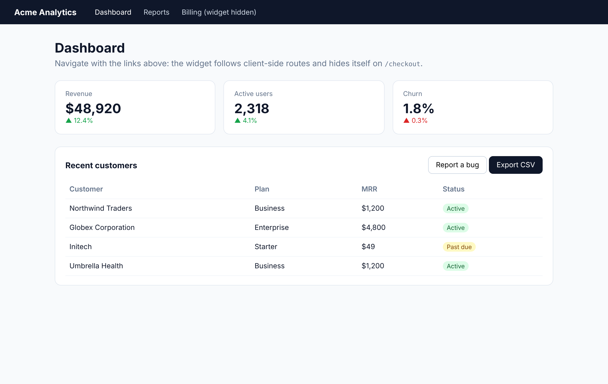
</p>

- 💬 **Feedback**, **Bug report** and **Suggestion** tabs, each with its own fields: title, "what happened", where in the app, expected vs. actual, a checklist, **severity / priority**, tags and sentiment
- 📸 Screenshots with no permission prompt, an editor to draw, highlight and **black out sensitive data**, plus **drag-and-drop, paste and file upload**
- 🎥 Screen recording that shows the **cursor and clicks**, lets users **draw on the page while recording**, and **keeps recording across tab switches and route changes**
- 🧾 Captured with every report: **all console logs**, **API calls** (fetch/XHR), **clicks and page changes with their route**, browser and page details. Users can see what's sent and leave logs out
- 🔌 Server-side integrations for **Slack** and **ClickUp**, with severity mapped to ClickUp priority and tags to ClickUp tags
- 🎨 **Matches any site**: colors (with separate dark-mode values), fonts (or your site's own), corner radius, shadow, width, launcher shape, custom CSS and `::part()` hooks
- 🪶 **Lightweight**: about 20 KB gzipped. The screenshot library (5 KB) loads only when someone takes a screenshot, and every field can be switched off
- 🧱 Styles live in a Shadow DOM, so your CSS can't break the widget and the widget can't break your CSS

## Screenshots

<table>
  <tr>
    <td width="50%">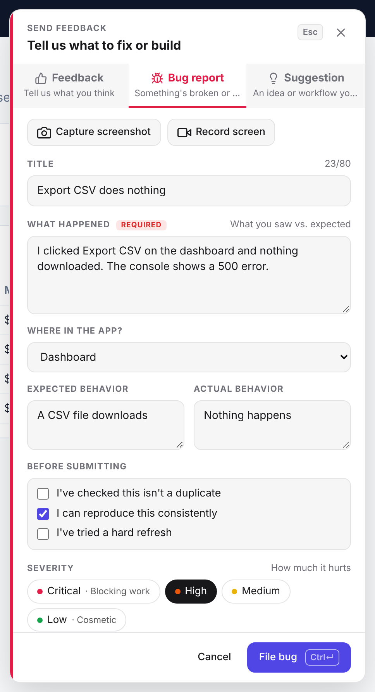</td>
    <td width="50%">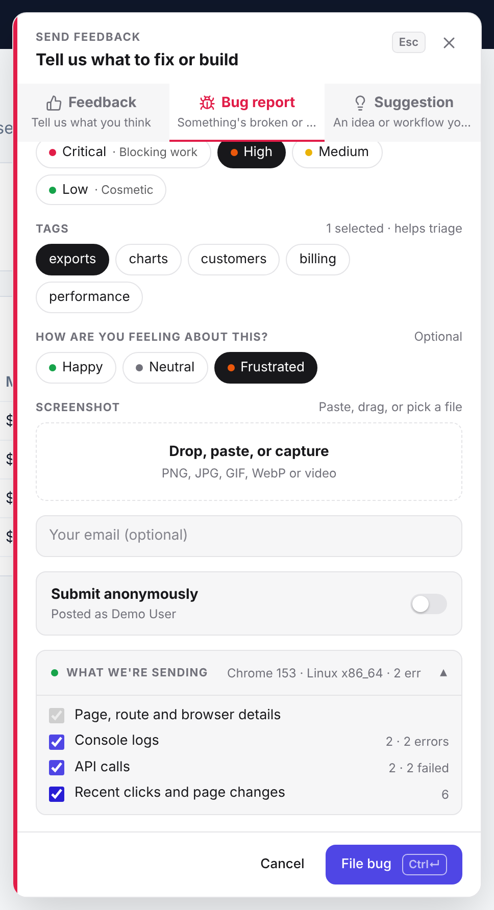</td>
  </tr>
  <tr>
    <td align="center"><b>Bug report</b>: title, details, area, expected vs. actual, checklist, severity</td>
    <td align="center"><b>Tags, sentiment, attachments</b>, anonymous toggle and <b>what we're sending</b></td>
  </tr>
</table>

**Make it look like your product:** the same widget with four `appearance` settings (default, warm paper, midnight, and a square-cornered serif brand look):

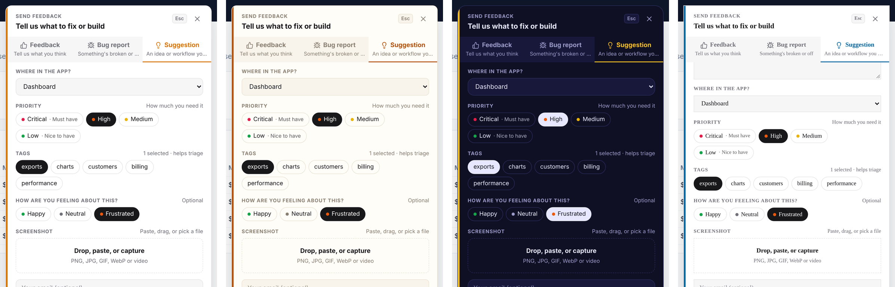

<table>
  <tr>
    <td width="34%">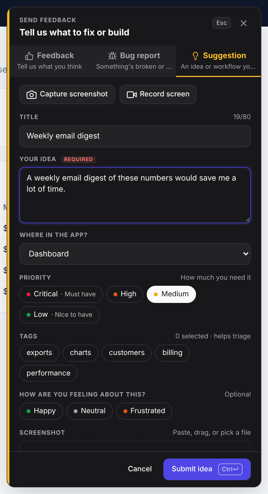</td>
    <td width="33%">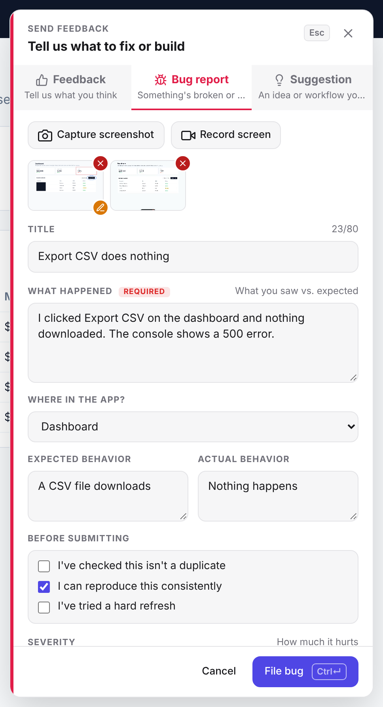</td>
    <td width="33%">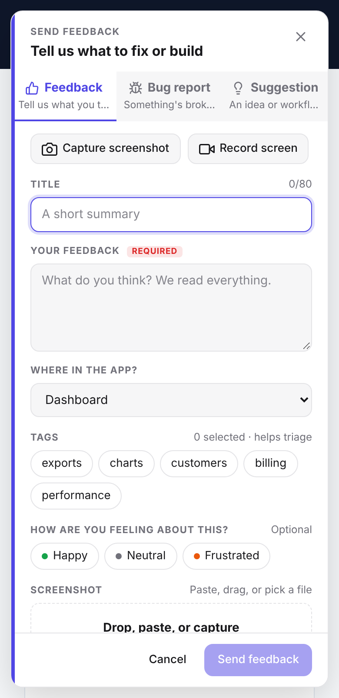</td>
  </tr>
  <tr>
    <td align="center"><b>Dark mode</b> (<code>theme: 'auto'</code>)</td>
    <td align="center"><b>Attachments</b>: remove ✕ or annotate ✎</td>
    <td align="center"><b>Mobile</b></td>
  </tr>
</table>

**Annotate screenshots:** draw, highlight an area, or black out sensitive data before attaching.

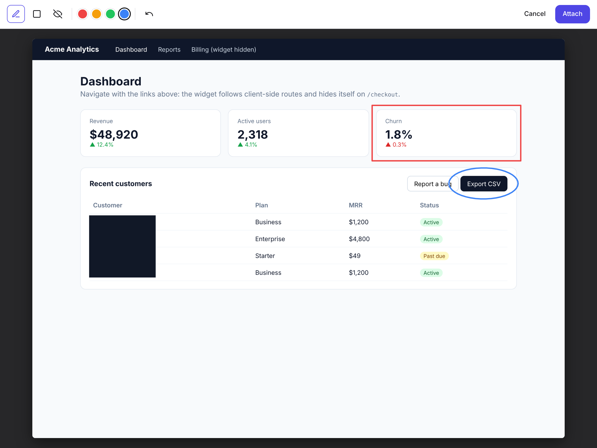

**Record the screen:** the video shows a cursor halo and click ripples. Users can switch on the pen and draw on the page while recording (the circle around *Export CSV* below), then switch it off to keep clicking.

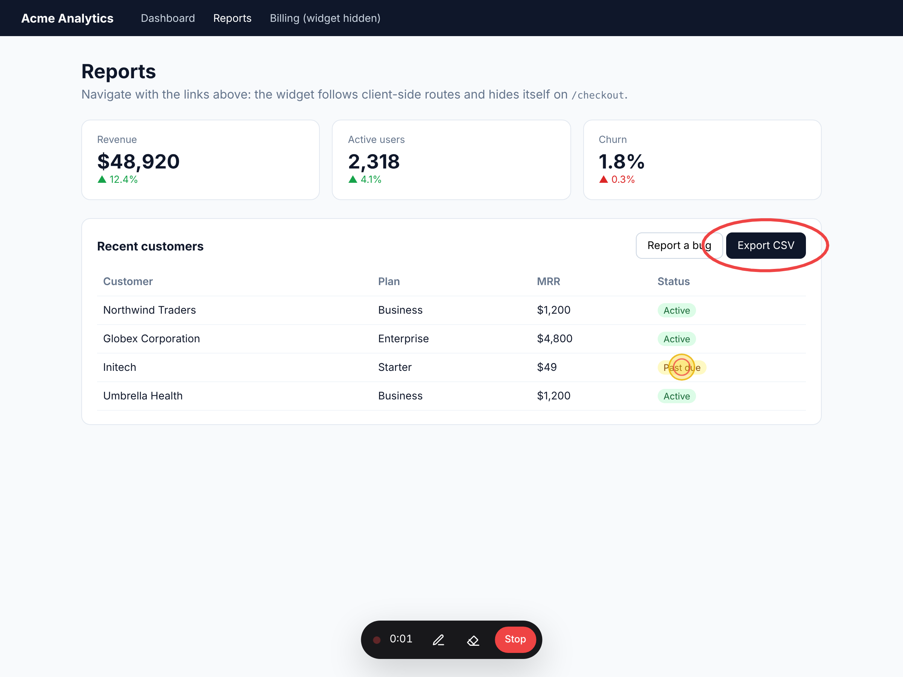

<table>
  <tr>
    <td width="60%">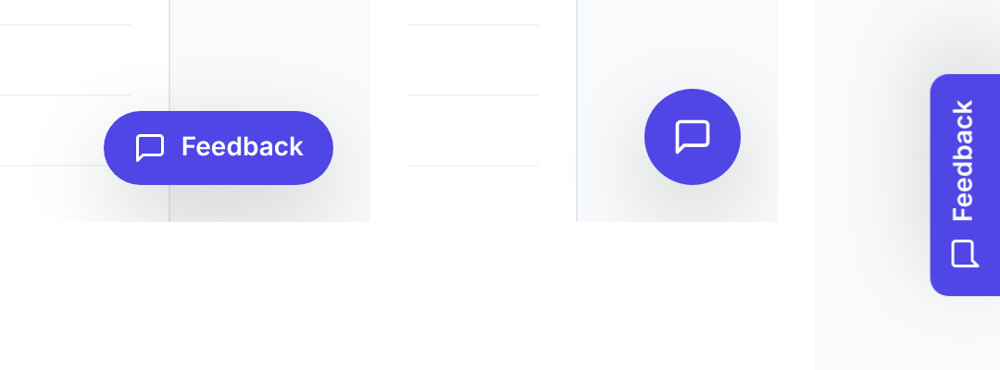</td>
    <td width="40%">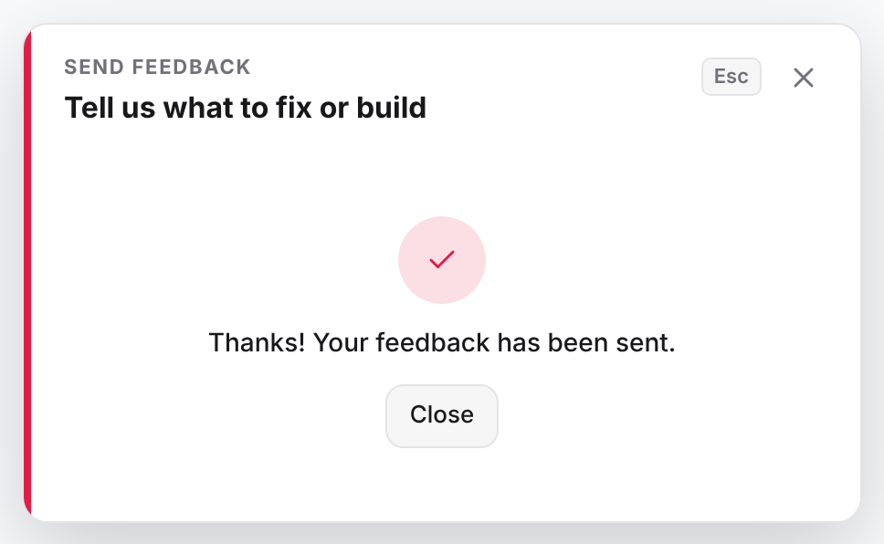</td>
  </tr>
  <tr>
    <td align="center"><b>Launcher shapes</b>: <code>pill</code>, <code>circle</code>, <code>tab</code></td>
    <td align="center"><b>Sent</b></td>
  </tr>
</table>

## Install

```bash
npm install feedback-management
```

## Quick start

Call `init()` **once** when your app starts:

```js
import { init } from 'feedback-management';

init({
  endpoint: '/api/feedback', // POST target (multipart/form-data), or use onSubmit
  user: { id: '42', email: 'jane@acme.com', name: 'Jane' },
  metadata: { appVersion: '2.3.0' },
});
```

A floating **Feedback** button now appears on every page.

### React

```jsx
import { FeedbackProvider, useFeedback } from 'feedback-management/react';

export function App() {
  return (
    <FeedbackProvider endpoint="/api/feedback" user={currentUser} pages={{ exclude: ['/checkout'] }}>
      <Routes />
    </FeedbackProvider>
  );
}

// Open the widget from any component:
function HelpMenu() {
  const feedback = useFeedback();
  return <button onClick={() => feedback.open('bug')}>Report a bug</button>;
}
```

To hide the button while a specific component is mounted, render `<HideFeedback />` inside it.

### Next.js (App Router)

The React entry is already marked `'use client'`, so you can use it directly in your root layout:

```tsx
// app/layout.tsx
import { FeedbackProvider } from 'feedback-management/react';

export default function RootLayout({ children }: { children: React.ReactNode }) {
  return (
    <html lang="en">
      <body>
        <FeedbackProvider endpoint="/api/feedback">{children}</FeedbackProvider>
      </body>
    </html>
  );
}
```

Function props such as `onSubmit` can't be passed from a Server Component. If you need them, wrap the provider in your own `'use client'` component.

### Vue / Angular / Svelte / anything else

Call `init()` once in your entry file (`main.ts`). Use `open()`, `close()` and `identify()` anywhere:

```ts
import { init, open, identify } from 'feedback-management';

init({ endpoint: '/api/feedback' });
// after login:
identify({ id: user.id, email: user.email });
```

### Plain HTML / CDN

Add one script tag to any page. Here is a complete page you can save as `feedback.html` and open:

```html
<!doctype html>
<html lang="en">
  <head>
    <meta charset="utf-8" />
    <title>My app</title>
  </head>
  <body>
    <h1>My app</h1>
    <button onclick="FeedbackWidget.open('bug')">Report a bug</button>

    <script src="https://unpkg.com/feedback-management/dist/feedback-widget.global.js"></script>
    <script>
      FeedbackWidget.init({
        // Without a backend, show the report in the console. Use `endpoint: '/api/feedback'` in production.
        onSubmit: (report) => console.log('Feedback report', report),
        user: { id: '42', name: 'Jane', email: 'jane@acme.com' },
        areas: ['Dashboard', 'Settings', 'Billing'],
        fields: { tags: ['ui', 'performance', 'data'] },
        appearance: { primary: '#0f766e', font: 'inherit', launcher: 'pill' },
      });
    </script>
  </body>
</html>
```

[`demo/index.html`](demo/index.html) is the full [live demo](https://ahmedz182.github.io/Feedback-management/) page. It's plain HTML, so you can read it to see every option in use.

## Choosing pages

```js
init({
  pages: {
    include: ['/app/**', '/settings/*'], // show only here (omit = every page)
    exclude: ['/app/checkout', /\/admin/], // never show here (takes precedence)
  },
});
```

| Rule | Matches |
| --- | --- |
| `'/pricing'` | exactly `/pricing` (a trailing slash is ignored) |
| `'/users/*'` | `/users/42`, but not `/users/42/edit` |
| `'/docs/**'` | `/docs`, `/docs/a`, `/docs/a/b/c` |
| `'https://app.acme.com/**'` | full-URL match (useful when several hosts share one bundle) |
| `/^\/beta/` | a RegExp, tested against the pathname and the full URL |
| `(url) => url.searchParams.has('debug')` | any custom logic |

The widget listens to `pushState`, `replaceState`, `popstate` and `hashchange`, so it updates on client-side navigation in React Router, Next.js, Vue Router and other routers. You don't need to wire anything up.

`open()` called from your own code works on every page. The `pages` rules only control the floating button.

## The report form

Each type has its own form. Every field below can be switched off with `fields`.

| Field | Shown for | Option |
| --- | --- | --- |
| Title, with an /80 character counter (falls back to the first line of the message) | all | `fields.title` |
| What happened / Your feedback / Your idea (**required**) | all | always |
| Where in the app?, preselected from the current route | all, when `areas` is set | `areas`, `fields.area` |
| Component | all | `fields.component` (off by default) |
| Expected behavior / Actual behavior | Bug | `fields.expectedActual` |
| Before submitting checklist | Bug | `fields.checklist` (`true`, your own `string[]`, or `false`) |
| **Severity** (Critical · High · Medium · Low) / **Priority** for suggestions | Bug, Suggestion | `fields.severity` (`true`, a list of types, or `false`) |
| Tags (multi-select chips) | all, when set | `fields.tags: string[]` |
| How are you feeling? (Happy · Neutral · Frustrated) | all | `fields.sentiment` |
| Drop, paste or browse for images/videos (25 MB total by default) | all | `fields.attachments`, `maxAttachmentMB` |
| Submit anonymously (removes `user` and `email` from the report) | when a `user` is set | `fields.anonymous` |
| What we're sending (users can untick console logs, API calls, clicks) | all | `fields.summary` |

```js
init({
  endpoint: '/api/feedback',
  // "Where in the app?": the first area whose `match` fits the current URL is preselected.
  areas: [
    { label: 'Dashboard', match: '/dashboard/**' },
    { label: 'Inbox', match: ['/inbox', '/inbox/**'] },
    { label: 'Settings', match: (url) => url.pathname.startsWith('/settings') },
    'Other',
  ],
  fields: {
    component: true,
    tags: ['prospects', 'deals', 'inbox', 'composer', 'search', 'calendar'],
    checklist: ["I've checked this isn't a duplicate", 'I can reproduce this consistently'],
    severity: ['bug'], // ask for priority on bugs only
    sentiment: false,
  },
  labels: { title: 'Tell us what to fix or build', bug: 'Bug report', suggestion: 'Feature request' },
});
```

The report then contains `title`, `severity`, `area`, `component`, `expected`, `actual`, `checklist`, `tags`, `sentiment`, `anonymous` and `attachments`, alongside the message. Keyboard shortcuts: <kbd>⌘/Ctrl</kbd> + <kbd>Enter</kbd> sends, <kbd>Esc</kbd> closes, and <kbd>⌘/Ctrl</kbd> + <kbd>V</kbd> pastes an image straight in.

## Theming: match any site

The widget renders inside a Shadow DOM, so it looks the same on every site until you decide otherwise. There are three ways to change that, from simplest to most flexible.

**1. `appearance` tokens.** Any CSS value works, including your own CSS variables:

```js
init({
  theme: 'auto', // 'light' | 'dark' | 'auto' (follows the OS)
  appearance: {
    primary: '#0f766e',          // buttons, focus rings, launcher
    primaryText: '#ffffff',
    background: '#fffdf8',
    surface: '#f8f4ec',          // inputs, cards, inactive tabs
    text: '#1c1917',
    muted: '#8a7f70',
    border: '#e9e1d3',
    danger: '#dc2626',
    bug: '#e11d48',              // accent per type: tab underline and panel edge
    feedback: 'var(--brand-500)',
    suggestion: '#b45309',
    dark: { background: '#0f1024', surface: '#17183a', text: '#e7e7ff', border: '#2b2d5c' },
    font: 'inherit',             // use your page's own font
    fontSize: '14px',
    radius: '8px',               // '0' for square corners
    shadow: '0 20px 60px rgba(0,0,0,.25)',
    panelWidth: '480px',
    launcher: 'tab',             // 'pill' | 'circle' | 'tab' (vertical, on the side edge)
  },
});
```

**2. `customCss`.** Extra CSS that is injected after the widget's own styles:

```js
init({ customCss: `.fb-launcher { letter-spacing: .02em; } .fb-chip { font-weight: 600; }` });
```

**3. `::part()` from your own stylesheet.** These parts are exposed: `launcher`, `panel`, `header`, `tabs`, `body`, `field`, `input`, `chip`, `button`, `submit`, `footer`, `dropzone` and `recording-bar`.

```css
[data-feedback-widget]::part(launcher) { box-shadow: none; text-transform: uppercase; }
[data-feedback-widget]::part(panel) { border: 2px solid black; }
```

Every piece of text can be replaced or translated through `labels` (see `FeedbackLabels` in the types).

## Size

| What ships | min + gzip |
| --- | --- |
| Widget (`feedback-management`): form, capture, recording, logs | ~20 KB |
| React bindings (`feedback-management/react`) | +0.5 KB |
| `html-to-image`, **loaded on demand** the first time someone takes a screenshot | 5 KB |
| CDN build (`feedback-widget.global.js`), everything included | 26 KB |

The server integrations (`feedback-management/server`) are a separate entry point and are never bundled into your frontend.

## What each report contains

Everything below is attached automatically, so the person fixing the bug doesn't have to ask "what were you doing?" or "what did the console say?".

| Field | What it holds | Default |
| --- | --- | --- |
| `context` | Page title, full URL, path, **query params**, hash, referrer, browser, language, timezone, viewport, screen | always |
| `breadcrumbs` | The user's last 50 **clicks and page changes** across the session, each with the element clicked, its label, and the **route and page title** it happened on | on |
| `consoleLogs` | The last 200 console messages at **every level** (`debug`, `log`, `info`, `warn`, `error`), plus uncaught errors and unhandled promise rejections | on |
| `networkLogs` | The last 100 **API calls** made with `fetch` or `XMLHttpRequest`: method, URL, status, duration, network errors, and optionally bodies | on |
| `recordingEvents` | Timestamped pointer path, clicks, scrolls, page changes and drawings during a recording (see below) | when a video is attached |

Example breadcrumb and API call:

```jsonc
// breadcrumbs[]
{ "type": "click", "timestamp": "2026-10-23T14:32:46.817Z", "target": "button#export", "text": "Export CSV",
  "path": "/dashboard?range=7d", "url": "https://app.acme.com/dashboard?range=7d", "title": "Dashboard · Acme" }
{ "type": "navigation", "timestamp": "2026-10-23T14:32:47.163Z", "path": "/reports", "title": "Reports · Acme",
  "url": "https://app.acme.com/reports", "from": "https://app.acme.com/dashboard?range=7d" }

// networkLogs[]
{ "type": "fetch", "method": "POST", "url": "https://app.acme.com/api/export?format=csv", "status": 500, "ok": false,
  "duration": 231, "timestamp": "2026-10-23T14:32:46.818Z" }
```

In Slack and ClickUp these become readable sections: **User actions before the report**, **Console errors & warnings** and **Failed API calls**. The complete logs are attached as `feedback-details.json`.

**Tuning:**

```js
init({
  capture: {
    consoleLimit: 200,        // console messages kept
    networkLimit: 100,        // API calls kept
    breadcrumbLimit: 50,      // clicks/page changes kept
    networkBodies: true,      // also keep request/response bodies (off by default)
    maxBodyLength: 2000,      // characters per body
    ignoreUrls: ['google-analytics.com', /\/healthz$/], // leave noisy calls out
  },
  features: { consoleLogs: true, networkLogs: true, breadcrumbs: true },
});
```

**Privacy safeguards:**

- Typed values are never recorded. Clicks store the element and its visible label, and `input` events store only which field changed.
- Sensitive query parameters (`token`, `key`, `password`, `auth`, `session`, `signature`…) are replaced with `[redacted]`.
- Request and response bodies are **off by default**. When you enable them, sensitive JSON keys and form fields are redacted, and only text/JSON responses are kept, truncated to `maxBodyLength`.
- The widget's own submission to `endpoint` and its own clicks are never logged.
- Call `init()` as early as possible, because only logs and requests made after setup are captured.

## Recording: drawing and mouse tracking

When a user records their screen:

- **Cursor and clicks are visible in the video.** A yellow halo follows the pointer and every click shows a red ripple, so reviewers can see exactly what was clicked.
- **Users can draw on the page while recording.** The ✏️ button in the recording toolbar turns on a pen, the eraser clears the drawings, and <kbd>Esc</kbd> or the ✏️ button switches back to normal clicking. Drawings are part of the video.
- **Every interaction is logged** with its time offset in the video and sent as `recordingEvents`:

```jsonc
[
  { "type": "navigation", "t": 0,    "url": "https://app.acme.com/", "title": "Dashboard · Acme" },
  { "type": "pointer",    "t": 140,  "x": 512, "y": 300 },
  { "type": "click",      "t": 318,  "x": 1018, "y": 326, "target": "button#export", "text": "Export CSV",
    "path": "/", "title": "Dashboard · Acme" },
  { "type": "navigation", "t": 365,  "url": "https://app.acme.com/reports", "title": "Reports · Acme" },
  { "type": "scroll",     "t": 900,  "x": 0, "y": 400 },
  { "type": "input",      "t": 1200, "target": "input#email" },
  { "type": "annotation", "t": 1814, "points": [[1100, 326], [1095, 340]] }
]
```

The Slack and ClickUp integrations turn this log into readable **steps to reproduce** (`0:01 Clicked "Export CSV" (button#export) on /dashboard`).

Privacy: what users type is never recorded. `input` events contain only the element, never its value, and click labels come only from buttons, links and similar controls. The widget's own clicks are ignored.

Each of these can be turned off: `features: { cursorHighlight: false, recordingDrawing: false, interactionLog: false }`.

### Recording is global: tabs and routes don't stop it

- **Switching tabs:** by default the share picker suggests a **window** (`recordingSurface: 'window'`), so the video keeps showing what the user sees when they move to another tab. `'screen'` also follows them into other apps, and `'tab'` records only your page. In tab mode, Chrome offers *Share this tab instead* to move the capture. Leaving and returning to the tab is logged as `visibility` events. The timer and the time limit keep counting correctly in background tabs.
- **Route changes:** client-side navigation never interrupts a recording, even to pages excluded by `pages`. The recording bar stays visible everywhere, and when the user stops, the form comes back with the video attached.
- **Full page loads** (a plain link to another page, or a reload) end the page and the recording with it. While recording, the browser asks *"Leave site?"* first.
- **One widget for the whole app:** calling `init()` again reconfigures the existing widget instead of creating a new one. Every `<FeedbackProvider>` shares it, so a layout that remounts on a route change keeps the recording going. When the last provider unmounts, the widget waits for a recording to finish before it is removed.


## Receiving feedback

### Option 1: `endpoint`

The widget `POST`s `multipart/form-data` with these fields:

| Field | Content |
| --- | --- |
| `payload` | JSON: `type`, `title`, `message`, `severity`, `area`, `component`, `expected`, `actual`, `checklist`, `tags`, `sentiment`, `anonymous`, `email`, `user`, `metadata`, `context`, `breadcrumbs`, `consoleLogs`, `networkLogs`, `recordingEvents` |
| `screenshot` | `screenshot.png` (if attached) |
| `video` | `recording.webm` or `recording.mp4` (if attached) |
| `attachment` | One field per dropped, pasted or picked file |

Any non-2xx response shows an error in the widget, and the user's message is kept so they can try again. To send auth headers, use `headers: { Authorization: 'Bearer …' }` or pass a function.

Express + multer example:

```js
import multer from 'multer';
const upload = multer({ dest: 'uploads/' });

app.post('/api/feedback', upload.fields([{ name: 'screenshot' }, { name: 'video' }, { name: 'attachment' }]), (req, res) => {
  const payload = JSON.parse(req.body.payload);
  const screenshot = req.files.screenshot?.[0];
  const video = req.files.video?.[0];
  const files = req.files.attachment ?? [];
  // save to your DB, create a Jira/Linear/GitHub issue, post to Slack…
  res.sendStatus(201);
});
```

Next.js route handler:

```ts
// app/api/feedback/route.ts
export async function POST(request: Request) {
  const form = await request.formData();
  const payload = JSON.parse(form.get('payload') as string);
  const screenshot = form.get('screenshot') as File | null;
  const video = form.get('video') as File | null;
  const files = form.getAll('attachment') as File[];
  // …store them
  return new Response(null, { status: 201 });
}
```

[`examples/server/index.mjs`](examples/server/index.mjs) is a complete backend with no dependencies. It saves reports to disk and forwards them to Slack/ClickUp when their environment variables are set.

### Option 2: `onSubmit`

```js
init({
  async onSubmit(payload) {
    // payload.screenshot and payload.video are Blobs, payload.attachments is File[]
    await myApi.createTicket(payload);
  },
});
```

If `onSubmit` throws, the widget shows an error. If you set both options, `onSubmit` runs first and then the POST is sent.

## Slack and ClickUp integrations

`feedback-management/server` receives the widget's submissions on **your** server and forwards them. It runs server-side because Slack and ClickUp tokens must never be shipped to the browser, and neither API accepts calls from a web page anyway.

```ts
// app/api/feedback/route.ts (Next.js App Router)
import { createFeedbackHandler } from 'feedback-management/server';

export const POST = createFeedbackHandler({
  slack: {
    botToken: process.env.SLACK_BOT_TOKEN!, // xoxb-…
    channel: 'C0123456789',
    channelByType: { bug: 'C0BUGS00000' },   // optional: bugs to their own channel
  },
  clickup: {
    token: process.env.CLICKUP_TOKEN!,       // pk_…
    listId: '901234567',
    listByType: { bug: '901234999' },        // optional: bugs into the engineering backlog
    priority: { suggestion: 4 },             // used when the user picked no severity (1 urgent … 4 low)
    assignees: [12345678],
  },
  onFeedback: async (feedback) => db.feedback.create({ data: feedback.payload }), // optional
});
```

The widget then only needs `init({ endpoint: '/api/feedback' })`.

**Express / Node:**

```js
import { createFeedbackHandler, toNodeHandler } from 'feedback-management/server';

const handler = createFeedbackHandler({ slack: { webhookUrl: process.env.SLACK_WEBHOOK_URL } });
app.post('/api/feedback', toNodeHandler(handler)); // mount before any multipart body parser
```

`createFeedbackHandler` returns a standard `(Request) => Response` function, so it also works in Remix, Hono, Bun, Deno and Cloudflare Workers.

### What gets created

| | Slack | ClickUp |
| --- | --- | --- |
| Title | `🐞 [Bug] The user's title` | Task name `[Bug] The user's title` |
| Fields | Severity/priority, area, component, tags and feeling as Slack fields | Severity → **ClickUp priority** (critical → urgent, high → high, medium → normal, low → low); area and tags → **ClickUp tags** |
| Body | Message, expected vs. actual, reporter (or *Anonymous*), page link, browser, recorded steps (or the last user actions), console errors, failed API calls | Markdown description: severity, area and tags, message, expected/actual, checklist, reporter, page and route, environment, recorded steps, user actions, console errors & warnings, failed API calls (with response bodies when captured), metadata |
| Files | Screenshot, video, uploaded files and `feedback-details.json` (full console, network and click logs) in the message thread (bot token only) | Screenshot, video, uploaded files and `feedback-details.json` as task attachments |
| Routing | `channelByType` | `listByType`, `priority` (fallback), `priorityFromSeverity`, `tags`, `assignees`, `status` |

### Slack setup

- **Quickest:** create an [incoming webhook](https://api.slack.com/messaging/webhooks) and pass `{ webhookUrl }`. This posts the message only, because webhooks can't upload files.
- **With attachments:** create a Slack app with the `chat:write` and `files:write` bot scopes, install it, invite the bot to the channel (`/invite @YourApp`), and pass `{ botToken, channel }`, where `channel` is the channel ID.

### ClickUp setup

1. Generate a personal API token in ClickUp under **Settings → Apps** (it starts with `pk_`).
2. Open the list where tasks should go. The list ID is the number after `/li/` in its URL.
3. Pass `{ token, listId }`.

### Behaviour

- Slack, ClickUp and `onFeedback` run in parallel.
- The handler responds `201` if **at least one** destination succeeded, so users aren't asked to resend a report that was already delivered. It responds `502` if all of them failed.
- Each failure is passed to `onError(error, destination)` (default: `console.error`), and the response body lists the destinations that failed.
- If the widget runs on a different domain from your API, set `allowedOrigins: ['https://app.acme.com']`.

You can also use the pieces on their own: `parseFeedback(request)`, `sendToSlack(feedback, options)`, `createClickUpTask(feedback, options)`, `reportMarkdown(feedback)`, `reportFacts(payload)`, `describeSteps(events)`, `describeBreadcrumb(crumb)` and `failedRequests(networkLogs)`.

## Options

| Option | Type | Default | Description |
| --- | --- | --- | --- |
| `endpoint` | `string` | — | URL to POST submissions to |
| `headers` | `object \| () => object` | — | Extra request headers |
| `onSubmit` | `(payload) => void \| Promise` | — | Handle submissions yourself |
| `onOpen` / `onClose` / `onError` | functions | — | Lifecycle hooks |
| `pages` | `{ include?, exclude? }` | all pages | Where the button is shown |
| `types` | `('feedback' \| 'bug' \| 'suggestion')[]` | `['feedback', 'bug', 'suggestion']` | Types offered, in order |
| `fields` | `FeedbackFields` | see [the report form](#the-report-form) | Which form fields to show |
| `areas` | `(string \| { label, match? })[]` | — | Options for "Where in the app?", preselected from the route |
| `maxAttachmentMB` | `number` | `25` | Total size limit for dropped/pasted files |
| `features.screenshot` | `boolean` | `true` | Allow screenshots |
| `features.video` | `boolean` | `true` | Allow screen recording |
| `features.email` | `boolean` | `true` | Ask for an email when `user.email` is unknown |
| `features.consoleLogs` | `boolean` | `true` | Attach recent console output (all levels) and uncaught errors |
| `features.networkLogs` | `boolean` | `true` | Attach recent fetch/XHR calls |
| `features.breadcrumbs` | `boolean` | `true` | Attach recent clicks and page changes with their route and page title |
| `capture` | `CaptureOptions` | see [above](#what-each-report-contains) | Buffer sizes, request bodies, ignored URLs |
| `features.cursorHighlight` | `boolean` | `true` | Cursor halo and click ripples in recordings |
| `features.recordingDrawing` | `boolean` | `true` | Pen for drawing on the page while recording |
| `features.interactionLog` | `boolean` | `true` | Send `recordingEvents` (pointer, clicks, scroll, navigation, drawings) |
| `screenshotMode` | `'dom' \| 'display'` | `'dom'` | `dom` renders the page silently. `display` uses the browser's share prompt for pixel-perfect captures of canvas, video and cross-origin iframes |
| `maxRecordingSeconds` | `number` | `120` | Recording time limit |
| `recordingSurface` | `'window' \| 'screen' \| 'tab'` | `'window'` | What the share picker suggests; `window`/`screen` keep recording across tabs |
| `user` | `{ id?, email?, name?, … }` | — | Attached to every report |
| `metadata` | `object \| () => object` | — | Attached to every report (resolved when the report is submitted) |
| `position` | `'bottom-right' \| 'bottom-left' \| 'top-right' \| 'top-left'` | `'bottom-right'` | Button and panel position |
| `primaryColor` | CSS color | `#4f46e5` | Accent color (shorthand for `appearance.primary`) |
| `theme` | `'light' \| 'dark' \| 'auto'` | `'light'` | `auto` follows the operating system |
| `appearance` | `FeedbackAppearance` | — | Colors, dark colors, font, radius, shadow, width, launcher shape; see [theming](#theming-match-any-site) |
| `customCss` | `string` | — | Extra CSS inside the widget |
| `zIndex` | `number` | `2147483000` | Stacking order |
| `hideLauncher` | `boolean` | `false` | Hide the floating button and open the widget with your own UI |
| `labels` | `Partial<FeedbackLabels>` | English | Override any text, for example to translate it |

## API

```ts
const widget = init(options); // or new FeedbackWidget(options)

widget.open('bug');        // open the panel, optionally preselecting a type
widget.close();
widget.toggle();
widget.hide();             // hide the button (e.g. during onboarding)
widget.show();
widget.identify(user);     // set or clear the current user
widget.setMetadata(meta);
widget.update(options);    // change some options at runtime; keeps the draft and any recording
widget.configure(options); // replace all options
widget.isRecording;        // true while a screen recording runs
await widget.whenIdle();   // resolves when no recording or screenshot is in progress
widget.destroy();          // remove the widget and restore console/history/fetch patches
```

The module-level `init`, `open`, `close`, `identify`, `destroy` and `getInstance` functions act on the one global widget.

## Browser support

- **Feedback form and screenshots:** all modern browsers.
- **Screen recording:** desktop Chrome, Edge, Firefox and Safari 13+, using `getDisplayMedia` and `MediaRecorder`. Where recording isn't supported (for example on most mobile browsers), the *Record screen* button is hidden automatically.
- **DOM screenshots:** cross-origin images without CORS headers render as blank. Use `screenshotMode: 'display'` if you need exact pixels.

## Development

```bash
npm install
npm test           # unit tests (vitest + jsdom)
npm run typecheck
npm run build      # dist/: ESM, CJS, .d.ts, and the CDN build
npm run demo       # live demo (no backend) at http://localhost:4173, same as GitHub Pages
npm run example    # demo app + backend at http://localhost:3000
                   # forwards to Slack/ClickUp when SLACK_WEBHOOK_URL, SLACK_BOT_TOKEN + SLACK_CHANNEL,
                   # or CLICKUP_TOKEN + CLICKUP_LIST_ID are set
```

## License

MIT
